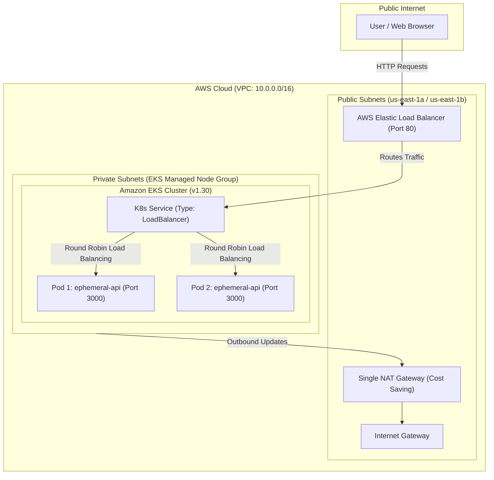

# 🐳 Ephemeral EKS Microservices Architecture ☸️

[](https://aws.amazon.com/eks/)
[](https://www.terraform.io/)
[](https://kubernetes.io/)
[](https://nodejs.org/)
[](https://www.docker.com/)

A production-grade, highly cost-optimized, and **ephemeral** microservices deployment on **AWS EKS** provisioned via **Terraform**. This project is designed specifically for DevOps portfolio demonstrations, technical showcase videos, and hands-on cloud native learning—without racking up unexpected cloud bills.

---

### 🌐 Live Project Showcase & Architecture Explorer
> 🚀 **Explore the Interactive Product Showcase**:  
> Visit the live GitHub Pages link: [**Live Architecture Explorer**](https://mohanabhishek29.github.io/k8s-eks-terraform-deployment/) to experience the **Interactive Topology Inspector**, **Real-Time Traffic Simulator**, and **Cloud Cost Calculator**!

### 📄 Official Architecture & Verification Report
> 📥 **Download Full Project Report**:  
> View the complete 19-screenshot AWS verification catalog and engineering documentation: [**Project Official Document.pdf**](Project%20Official%20Document.pdf)

---

## ⚠️ CRITICAL BILLING & COST AWARENESS

> [!CAUTION]
> **EKS IS NOT IN THE AWS FREE TIER.**
> - **EKS Control Plane**: ~$0.10/hour (~₹8.50/hr).
> - **2x t3.medium EC2 Instances**: ~$0.0416/hr each (~₹7.00/hr total).
> - **Single NAT Gateway**: ~$0.045/hour (~₹3.80/hr).
> - **Estimated Run Cost**: **~$0.23/hour (~₹19.50/hour)**.
>
> **The Golden Ephemeral Rule**:
> Run `terraform apply` ➔ Verify app & record demo video (15-20 mins) ➔ **Immediately run teardown script** (`./scripts/destroy-aws.ps1`).

---

## 🏛️ System Architecture



---

## 📁 Repository Structure

```
eks-ephemeral-microservices/
├── app/
│   ├── Dockerfile             # Multi-stage optimized Docker build (Alpine)
│   ├── .dockerignore          # Clean build context
│   ├── package.json           # Node.js dependencies
│   └── server.js              # REST API & Interactive Pod Dashboard
├── k8s/
│   ├── deployment.yaml        # 2 Replicas, Health Probes, Resource limits
│   └── service.yaml           # AWS LoadBalancer Service (Port 80 -> 3000)
├── terraform/
│   ├── provider.tf            # AWS Provider & default resource tagging
│   ├── variables.tf           # Configurable region, cluster name, nodes
│   ├── vpc.tf                 # VPC, 4 Subnets, IGW, 1x NAT Gateway, ELB tags
│   ├── eks.tf                 # EKS Cluster & t3.medium Managed Node Group
│   ├── outputs.tf             # Outputs & kubectl connection command
│   └── terraform.tfvars.example
├── scripts/
│   ├── local-test.ps1         # 1-Click local Docker container verification
│   ├── deploy-aws.ps1         # Automated AWS EKS Terraform + K8s deployment
│   └── destroy-aws.ps1        # Safe teardown (prevents orphan ELB charges)
├── docker-compose.yml         # Local multi-replica testing without cloud
└── README.md
```

---

## 🛠️ Prerequisites

Before getting started, make sure you have the following installed:

1. **Docker Desktop** (running with WSL2 backend or Hyper-V)
2. **Terraform** (`v1.5+`)
3. **AWS CLI** (`v2.x`)
4. **kubectl** (`v1.28+`)
5. **Node.js** (`v18+` or `v20+`)

---

## 🧪 Phase 1: Local Testing (Zero Cost)

Before spending a single cent on AWS, test everything locally on your laptop:

### Option A: Using the Automated PowerShell Script
```powershell
.\scripts\local-test.ps1
```
This builds the Docker image and opens `http://localhost:3000` in your browser.

### Option B: Using Docker Compose (2 Replicas)
```powershell
docker-compose up --build
```
- Open `http://localhost:3000` in your browser to verify Pod 1.
- Open `http://localhost:3001` in your browser to verify Pod 2.
- Stop when done:
```powershell
docker-compose down
```

---

## 📦 Phase 2: Build & Push Container Image

AWS EKS needs to pull your container image. You can push it to your **Docker Hub**:

1. Log in to Docker Hub:
   ```bash
   docker login
   ```
2. Build and tag your image:
   ```bash
   docker build -t <your-dockerhub-username>/ephemeral-api:v1.0.0 ./app
   ```
3. Push to Docker Hub:
   ```bash
   docker push <your-dockerhub-username>/ephemeral-api:v1.0.0
   ```
4. Update `k8s/deployment.yaml`:
   Replace `REPLACE_WITH_YOUR_DOCKERHUB_USERNAME` with your actual username:
   ```yaml
   image: <your-dockerhub-username>/ephemeral-api:v1.0.0
   ```

---

## 🚀 Phase 3: Deploy to AWS EKS

### 1. Authenticate with AWS
```powershell
aws configure
```
*(Enter your AWS Access Key ID, Secret Key, and default region: `us-east-1`)*

Verify identity:
```powershell
aws sts get-caller-identity
```

### 2. Deploy Infrastructure with Terraform
```powershell
cd terraform
terraform init
terraform apply -auto-approve
```
> ⏱️ *Note: EKS cluster and Managed Node Group creation typically takes 10 to 12 minutes. Grab a cup of water while AWS provisions the control plane.*

### 3. Connect `kubectl` to EKS
When Terraform finishes, configure your local `kubectl` to talk to the new cluster:
```powershell
aws eks --region us-east-1 update-kubeconfig --name ephemeral-eks-cluster
```

Verify nodes are running:
```powershell
kubectl get nodes
```
*(You should see 2 `t3.medium` worker nodes with status `Ready`)*

---

## ☸️ Phase 4: Deploy Kubernetes Manifests

```powershell
cd ../k8s
kubectl apply -f deployment.yaml
kubectl apply -f service.yaml
```

Check the status of Pods and Service:
```powershell
kubectl get pods
kubectl get service ephemeral-api-service
```

### 4. Access the Live Microservice
Look for the `EXTERNAL-IP` (AWS LoadBalancer URL):
```
NAME                    TYPE           EXTERNAL-IP
ephemeral-api-service   LoadBalancer   a123b456-789.us-east-1.elb.amazonaws.com
```
Copy that URL into your browser:
```
http://a123b456-789.us-east-1.elb.amazonaws.com
```

---

## 🎥 Phase 5: Demo & Screen Recording Checklist

For your portfolio or YouTube/LinkedIn demo video:
1. **Show Terminal**: Display `kubectl get nodes` and `kubectl get pods -o wide` showing 2 replicas running on separate worker nodes.
2. **Open Browser**: Open the LoadBalancer DNS URL.
3. **Showcase Load Balancing**: Refresh the page—watch the **Serving Pod (Hostname)** rotate between the two replicas.
4. **Test REST API**:
   - `GET /health` ➔ Returns `200 OK` with JSON status and pod uptime.
   - `GET /api/tasks` ➔ Returns active tasks.
   - Add a task in the UI to demonstrate write capability.
5. **Explain Architecture**: Show the Terraform code and highlight the cost-saving 1x NAT Gateway design.

---

## 🛑 Phase 6: IMMEDIATE Teardown (Stop All Billing)

> [!WARNING]
> **DO NOT run `terraform destroy` without deleting the Kubernetes service first!**
> If the Kubernetes Service exists, the AWS Load Balancer will lock the VPC Subnets and cause `terraform destroy` to fail with dependency errors.

### The Safest Way: Run the Teardown Script
```powershell
.\scripts\destroy-aws.ps1
```

### Or Manual Step-by-Step Cleanup:
```powershell
# 1. Delete Kubernetes resources first
cd k8s
kubectl delete -f service.yaml
kubectl delete -f deployment.yaml

# 2. Wait 60 seconds for AWS to deregister the ELB and release Network Interfaces (ENIs)
Start-Sleep -Seconds 60

# 3. Destroy Terraform infrastructure
cd ../terraform
terraform destroy -auto-approve
```

### 4. Final Sanity Check in AWS Console
Log into AWS Console and verify these are empty:
- **Elastic Container Service / EKS**: 0 Clusters.
- **EC2 Dashboard**: 0 Running Instances, 0 Volumes, 0 Elastic IPs, 0 Load Balancers.
- **VPC Dashboard**: 0 NAT Gateways.

---

## 🛡️ Best Practices Implemented

| Feature | Implementation | Benefit |
| :--- | :--- | :--- |
| **Multi-Stage Docker** | Alpine base + non-root `node` user | Minimal attack surface, ~120MB image size |
| **Health Checks** | Liveness & Readiness probes on `/health` | Kubernetes self-healing and zero-downtime rollouts |
| **Resource Quotas** | CPU/Memory limits in `deployment.yaml` | Prevents OOM kills and "noisy neighbor" issues |
| **Cost Optimization** | Single NAT Gateway instead of multi-AZ NAT | Saves 50% on NAT Gateway hourly rates for ephemeral runs |
| **Tagging Automation** | Explicit ELB subnet discovery tags | Clean zero-configuration AWS LoadBalancer attachment |
| **Zero-Orphan Cleanup** | Automated teardown script | Guarantees no lingering resources or surprise credit card bills |

---

## 👨‍💻 Author
**Cloud & DevOps Engineer**  
- Portfolio / GitHub: [k8s-eks-terraform-deployment](https://github.com/)

